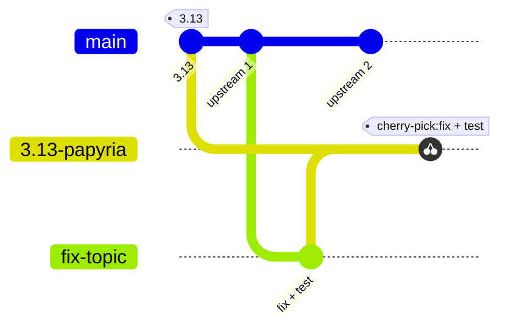
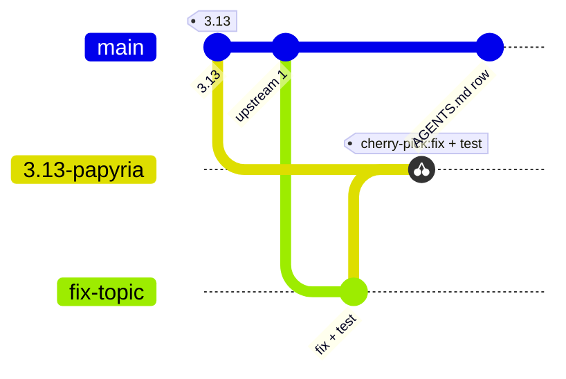
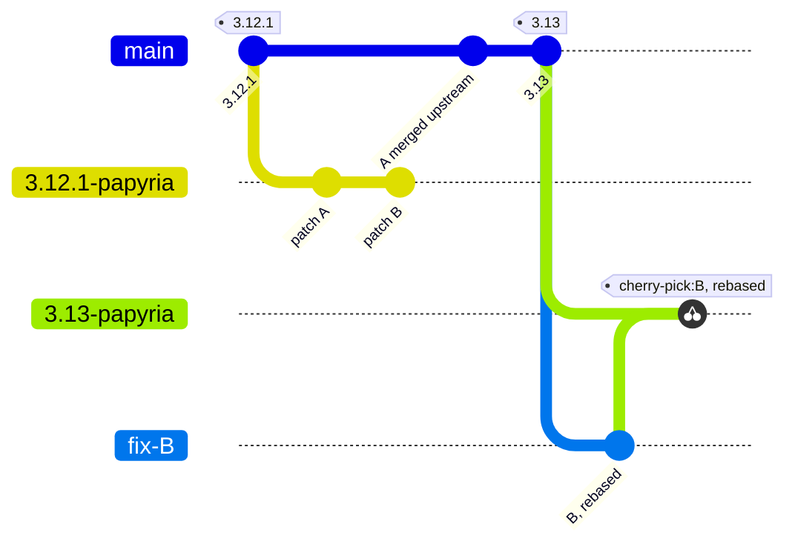

# Working in the Papyria fork of pandoc

This is [Papyria](https://github.com/papyria)'s fork of
[jgm/pandoc](https://github.com/jgm/pandoc). Read this before you change anything
here, whether you are a person or an agent. Most of it is about git: which branch a
change goes on, and where it must never go.

We build our own pandoc because we depend on fixes that no pandoc release has yet. We do not want a fork that drifts
away from upstream. Every patch we carry is on its way upstream, and we drop it as
soon as a pandoc release includes it.

## The rules

1. **Every patch is on its own `fix-<topic>` branch**, branched from `upstream/main`.
   One logical change, one commit if possible.
2. **Every patch has a test**: a `test/command/<issue>.md` command test that fails
   without the fix. Run the whole suite before pushing (see [Build and test](#build-and-test)).
3. **Never merge a patch into `main`.** `main` mirrors `upstream/main`. The only
   commits on it that jgm/pandoc does not have are the ones that touch `AGENTS.md`.
   A pull request into this fork's `main` is always wrong, whatever it changes
   besides this file.
4. **We build from an integration branch, `X.Y-papyria`**: the pandoc release tag
   `X.Y` with every patch that release lacks cherry-picked onto it (`-x`). Never
   from `upstream/main`, which ships unreleased changes we have not asked for.
5. **Every patch goes upstream**, as an issue and a pull request on jgm/pandoc that
   follows pandoc's own conventions (below). First it bakes on the integration branch
   while we try it on real documents. We open the upstream issue only once we have
   learned that the patch is good. A patch we never intend to send upstream is not
   allowed. While it bakes, it has a row in
   [Carried patches](#carried-patches) and an open Papyria Linear issue that stays open
   until the upstream PR exists.
6. **Before you write a patch, check upstream.** Search jgm/pandoc's issues, pull
   requests and the commits on `main` since the last release. If upstream has already
   fixed it, carry upstream's commit instead (see
   [A fix upstream has merged](#a-fix-upstream-has-merged-but-not-released)).

## Branches

| Branch | What it is | Who changes it |
|---|---|---|
| `main` | `upstream/main`, plus `AGENTS.md`. | Syncing with upstream, and edits to this file. |
| `fix-<topic>` | One patch, on `upstream/main`. The head branch of its upstream PR. | The patch author. Rebased on `upstream/main` regularly. |
| `X.Y-papyria` | Release tag `X.Y` plus every patch it lacks, cherry-picked with `-x`. What we build. | Whoever adds a patch or moves to a new release. |



`main` keeps following upstream. A patch starts from `main` and is cherry-picked
onto the integration branch, never merged into `main`. The integration branch starts
from a release tag and never takes anything from `main` except a cherry-picked patch.

## Workflow

### A new patch

1. Check upstream first (rule 6).
2. Write down a minimal, reproducible example: the smallest input, the command, what
   pandoc writes and what it should write. Never a customer's document. It becomes
   the test now and the upstream issue later.
3. `git fetch upstream && git switch -c fix-<topic> upstream/main`.
4. Make one logical commit with a test under `test/command/<topic>.md`. Follow
   upstream's [CONTRIBUTING.md](CONTRIBUTING.md): a first line of about 50
   characters (the writer or reader it touches, then what it does:
   `Docx reader: read w:fldSimple fields.`), a blank line, then the why. Keep every
   line of the message at 78 characters or less; upstream CI checks it. No
   `Co-Authored-By` or session trailers. Code is `-Wall` clean and wrapped at 80
   columns.
5. Build and run the full test suite, plus the `pandoc-lua-engine` suite
   ([Build and test](#build-and-test)).
6. Push the branch to this fork.
7. Bring every other open `fix-*` branch current with `upstream/main`
   ([Keeping a patch current](#keeping-a-patch-current)). Do this each time a patch
   is added to the integration branch.
8. Cherry-pick the commit with `-x` onto the current `X.Y-papyria`. If it does not
   apply, resolve the conflicts on `X.Y-papyria`
   ([When a cherry-pick does not apply](#when-a-cherry-pick-does-not-apply)). Run the
   tests there too, and push.
9. Our build pins an `X.Y-papyria` commit by its SHA, so moving the branch ships
   nothing by itself: move the pin to the new head.
10. Add the patch to [Carried patches](#carried-patches), on `main`, as **Baking**,
    with its Linear issue.
11. Let it bake. Use it on real documents until we have learned that it is good.
12. Open an issue on jgm/pandoc with the example from step 2.
13. Open the upstream PR from `fix-<topic>` against `jgm/pandoc:main`, saying
    `Closes #<issue>`. Rename the test to `test/command/<issue>.md` if upstream's
    convention asks for it, and update the row.



### Keeping a patch current

Rebase every open `fix-*` branch on `upstream/main` whenever you sync `main`, and at
least before each new release, so its upstream PR still merges cleanly:

```bash
git fetch upstream
git switch fix-<topic>
git rebase upstream/main
git push --force-with-lease
```

Force-pushing a `fix-*` branch is fine: it is the PR's head branch, and nothing
builds from it. If the rebase changed the patch itself, cherry-pick the new commit
onto `X.Y-papyria` and move the pin to the new head.

A patch always targets `upstream/main`, never the release tag, even when the two
have drifted apart. That is the version upstream will review and merge.

### When a cherry-pick does not apply

`X.Y-papyria` starts from a release tag, and `upstream/main` moves on after it. Now
and then `main` has changed the code a patch touches so much that the patch, written
against `main`, does not apply to the tag. Resolve the conflicts on `X.Y-papyria`,
keeping the patch's intent in the tag's code, then run the tests and
`git cherry-pick --continue`. Conflicts on the tag side are usually the reverse of
what `main` changed: the tag lacks code the patch expects.

Never change the `fix-*` branch to fit the tag. It stays on `upstream/main`.

### A fix upstream has merged but not released

Cherry-pick upstream's own commit from `upstream/main` onto `X.Y-papyria` with `-x`.
No `fix-*` branch. Give it a row in Carried patches until a release includes it.

### A new upstream release

When pandoc `X.Z` is released:

1. `git fetch upstream --tags`
2. `git switch -c X.Z-papyria X.Z`
3. For each carried patch, check whether `X.Z` includes it
   (`git log X.Y..X.Z --grep=<subject>`, and the upstream PR's merge date against the
   tag date). Move those to [Accepted upstream](#accepted-upstream).
4. Rebase the remaining `fix-*` branches on `upstream/main`, then cherry-pick (`-x`)
   each one onto `X.Z-papyria`. Also cherry-pick upstream commits merged after `X.Z`
   that we carry.
5. `rm -rf dist-newstyle`, then build and run the tests ([Build and test](#build-and-test)).
   Push.
6. Move our build's pin to the new head.
7. Delete the previous `X.Y-papyria` only after nothing pins one of its commits.



If a release includes every patch, we drop the fork and build from the stock pandoc
release.

### When an upstream PR is merged

Delete its `fix-*` branch here and locally. Keep its cherry-pick on `X.Y-papyria`
until a release includes it, and mark its row merged.

### Syncing `main`

```bash
git fetch upstream
git switch main
git merge upstream/main
git push
```

This never conflicts, because upstream has no `AGENTS.md`, and never needs a
force-push. Afterwards, `git diff --stat upstream/main main` must list `AGENTS.md`
and nothing else. If it lists anything more, a patch has landed on `main`: move it
to a `fix-*` branch and reset `main`.

Upstream's `.gitignore` ignores top-level files with a dot in their name, so this
file is committed with `git add -f`. Don't change `.gitignore`.

## Build and test

```bash
cabal update
cabal test --enable-tests pandoc:test-pandoc pandoc-lua-engine:test-pandoc-lua-engine
```

- `--enable-tests` is needed, or the solver drops the `pandoc-lua-engine` test suite
  and cabal refuses to run it.
- If the solver rejects a version that a `.cabal` file asks for, the local Hackage
  index is stale: run `cabal update` again (a mirror can answer 403 and leave the
  index as it was).
- After moving to a new release tag, `rm -rf dist-newstyle` first. Stale artifacts
  from the old version have made `pandoc-cli` fail with a mismatched `PandocError`
  type, and made patch tests fail as if the patch were missing.
- `-p <pattern>` after `--test-options=` runs a subset, such as one command test.

## Carried patches

Current integration branch: **`3.13-papyria`** (based on pandoc 3.13).

| Branch | Upstream issue / PR | Commit | Status | Why Papyria needs it |
|---|---|---|---|---|
| _(upstream)_ | jgm/pandoc#12003 | EPUB writer: fix id clash with added title header. (`d4c1c4784`) | Merged 2026-10-28, after 3.13 | The leading untitled section took a chapter heading's id, so the nav and links pointed at the wrong file (PAP-709). |

## Accepted upstream

Patches that a pandoc release includes, so we no longer carry them.

| Upstream issue / PR | Commit | Released in |
|---|---|---|
| jgm/pandoc#11862 / jgm/pandoc#11863 | Markdown writer: escape list markers after a line break. | 3.12.1 |
| jgm/pandoc#11944 / jgm/pandoc#11946 | Docx reader: read w:fldSimple fields. | 3.13 |
| jgm/pandoc#11945 / jgm/pandoc#11947 | Markdown writer: write wide tables as grid tables. | 3.13 |
| jgm/pandoc#11971 / jgm/pandoc#11972 | Docx reader: keep tracked paragraph marks inside notes. | 3.13 |

## Declined upstream

Patches upstream will not take, so Papyria solves the problem outside pandoc.

| Upstream issue / PR | Commit | Instead |
|---|---|---|
| jgm/pandoc#11985 / jgm/pandoc#11986 | Markdown writer: keep emphasis delimiters flanking | Moving characters out of emphasis changes the document, which the writer must not do. papyria-workflows' `PandocClient` moves them in the AST between reading and writing (PAP-1123). |
